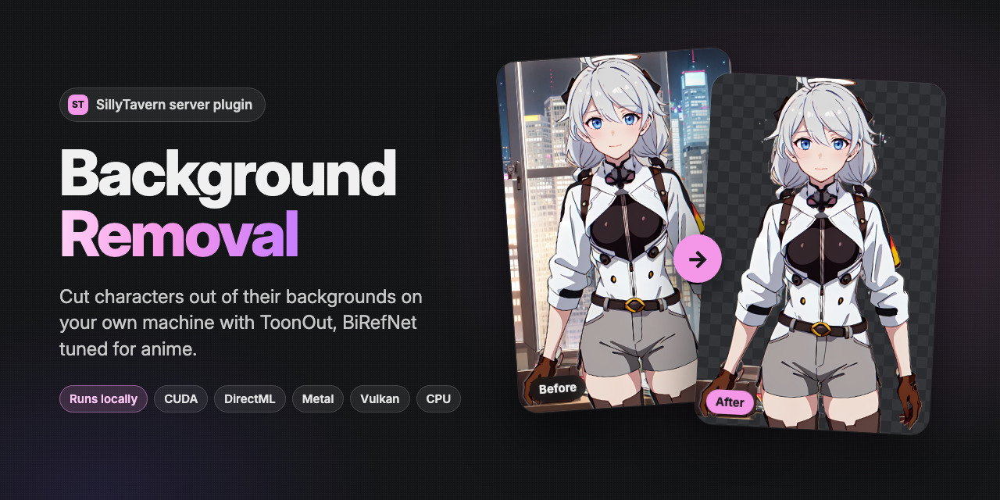

# Background Removal for SillyTavern

A SillyTavern server plugin that cuts images out of their background on your own machine.
It runs [ToonOut](https://huggingface.co/joelseytre/toonout), a BiRefNet fine-tuned for
anime that keeps BiRefNet's accuracy on real people, through native ONNX Runtime.



The repo is two things at once: a **server plugin** that does the cutting on your machine,
and a small **UI extension** that gives you a button and a slash command for it. You don't need
any particular theme. The [Yodayo Tavern Theme](https://github.com/pervertir/SillyTavern-YodayoTavernTheme)
uses the same server plugin for its own Remove background button, and any extension can call
its API.

## Install

Install it twice from the same link, once as each half:

**1. Server plugin** (does the work)

1. Turn on server plugins: set `enableServerPlugins: true` in SillyTavern's `config.yaml`.
2. In SillyTavern's `plugins` folder:
   ```
   git clone https://github.com/pervertir/SillyTavern-BackgroundRemoval
   cd SillyTavern-BackgroundRemoval
   npm install
   ```
3. Restart SillyTavern. The console shows `[background-removal] ready`.

The first image downloads the model (974 MB) into the plugin's `models` folder. With
`enableServerPluginsAutoUpdate` on, SillyTavern keeps the plugin up to date; run
`npm install` again after an update that changes its dependencies.

**2. UI extension** (the button and the command)

In SillyTavern open **Extensions → Install extension** and paste
`https://github.com/pervertir/SillyTavern-BackgroundRemoval`. If the server plugin is
missing, the extension shows these steps the first time you use it.

## Use

- **A character's picture:** open the character, then **More… → Remove background**. The
  cutout is saved to the character's gallery and shown on a checkerboard with a Download
  button.
- **Slash command:** `/bgremove` cuts out the open character's picture, `/bgremove <image URL>`
  any image. It returns the saved cutout's path, so it chains in STscript and Quick Replies,
  for example `/bgremove | /echo {{pipe}}`. Add `show=true` to see the result. Alias:
  `/removebg`.

## Hardware

The plugin picks the fastest backend this machine has, and falls back to the next one if
a backend fails:

| Backend | Where |
| --- | --- |
| CUDA | Linux x64 with an NVIDIA GPU (CUDA 12) |
| DirectML | Windows, any DirectX 12 GPU (NVIDIA, AMD, Intel) |
| WebGPU | macOS through Metal (Apple silicon), Linux through Vulkan (AMD, Intel) |
| CPU | everywhere else |

CoreML isn't used by default: it splits this model into over 200 parts and needs more than
30 GB of memory. On an Apple M4 a 1024×1024 pass takes about 4 seconds through WebGPU.

The loaded model holds several GB, so it's released after 10 minutes unused.

Environment variables:

- `BGREMOVE_BACKEND`: force one backend (`cuda`, `dml`, `webgpu`, `coreml` or `cpu`).
- `BGREMOVE_MODEL`: path to another BiRefNet-style ONNX model (1024×1024 input).

## API

Under `/api/plugins/background-removal`, with SillyTavern's usual request headers:

- `GET /status`: `{ status, backend, received, total, error, model }`. `status` is `idle`,
  `downloading`, `loading`, `ready` or `error`; `received` and `total` give the model
  download's progress.
- `POST /remove` with `{ image: "<base64>" }` (a data URL works too): returns
  `{ image: "<base64 PNG>", backend }`, the same size as the input, with the background
  transparent.

Requests run one at a time.

## License

MIT. ToonOut and the [ONNX export](https://huggingface.co/sprited/birefnet-toonout-onnx)
used here are MIT too.
